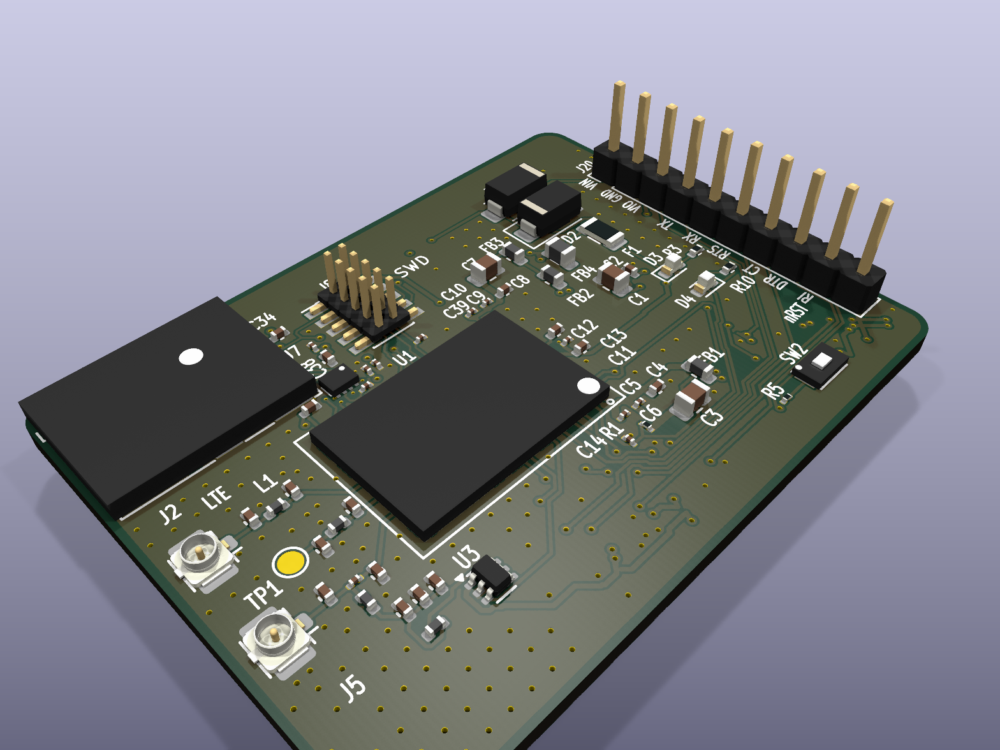
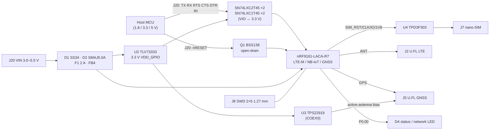
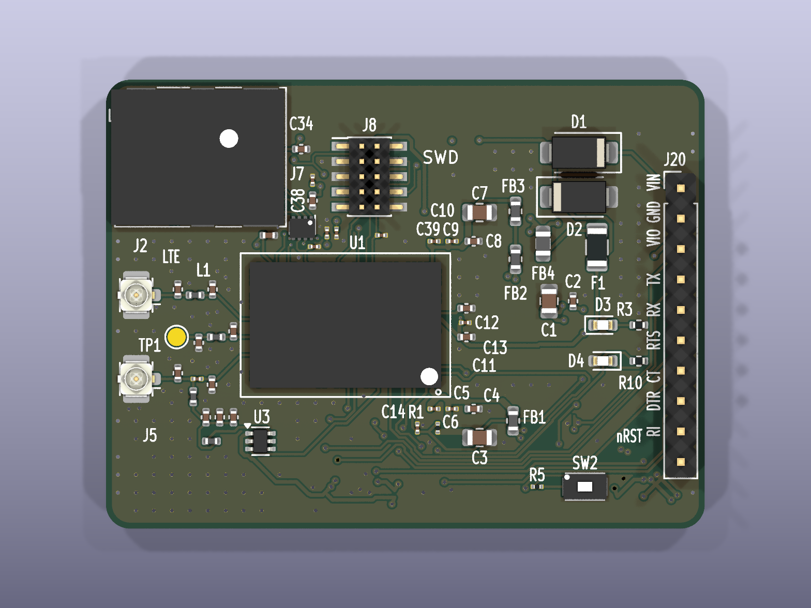
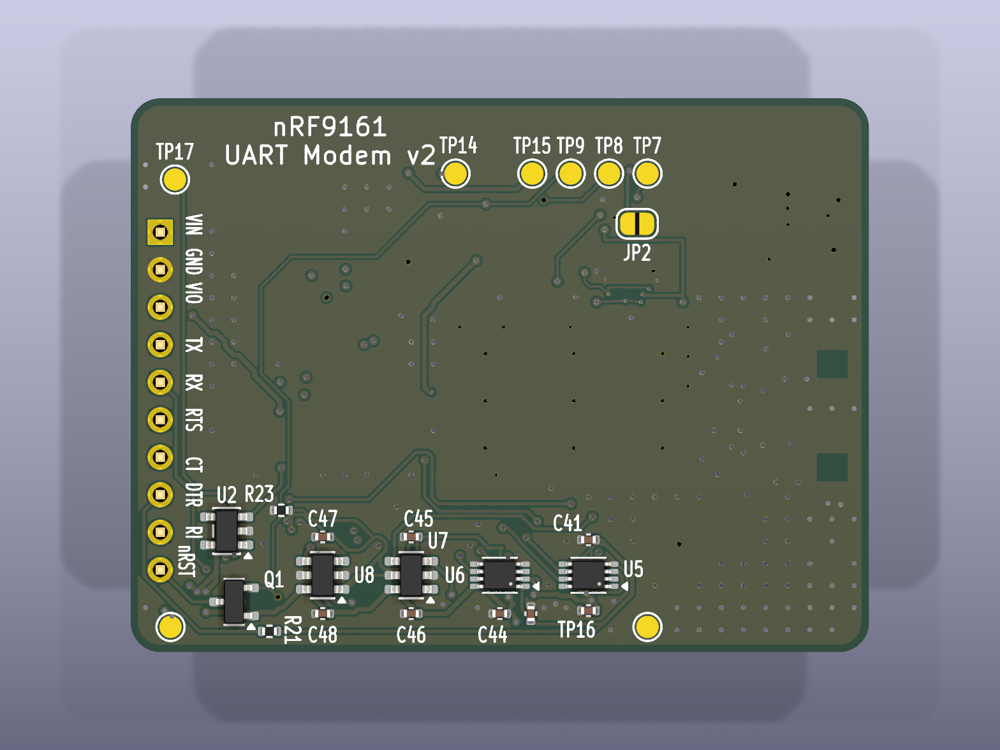
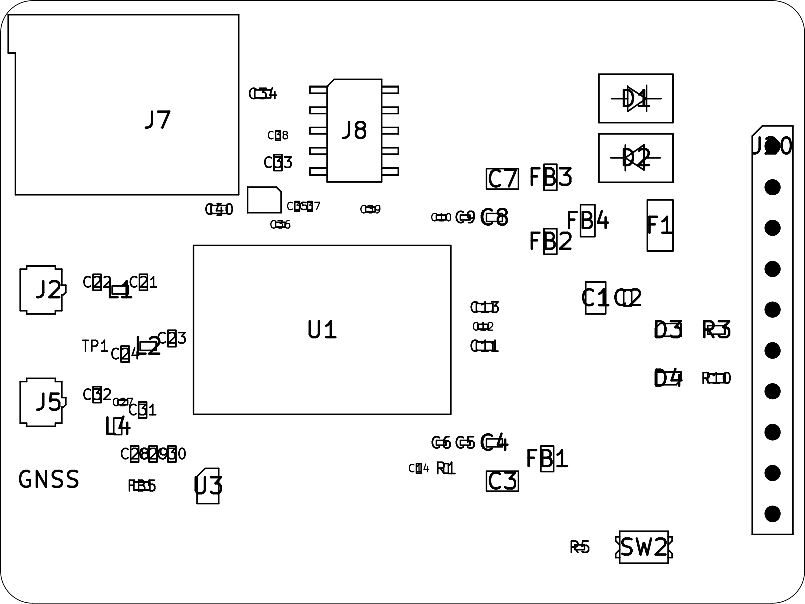
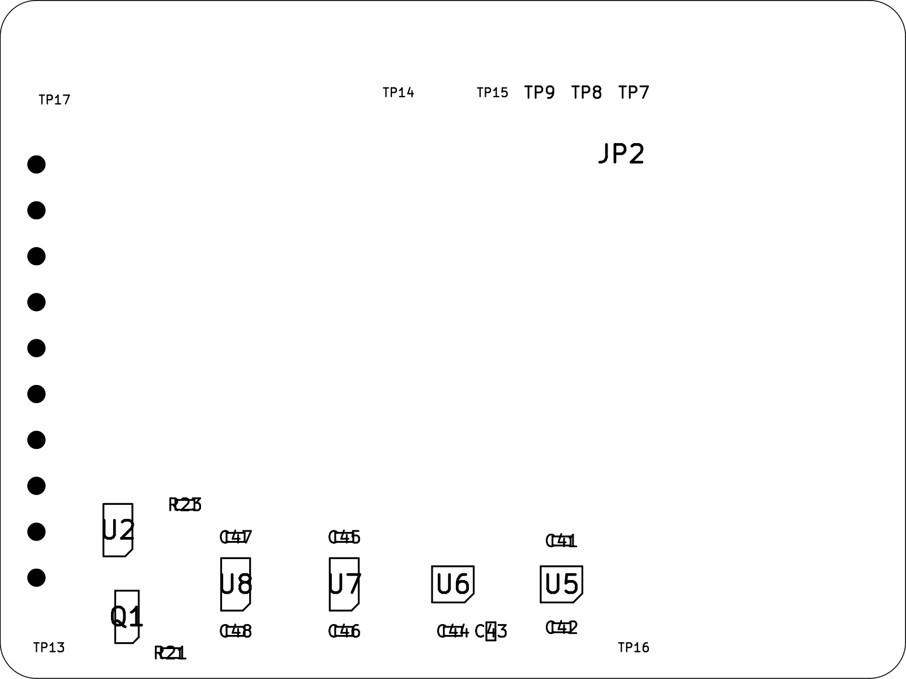

# nRF9161 UART Modem Module (v2)

A small 50 × 37.5 mm LTE-M / NB-IoT + GNSS modem board built around the Nordic **nRF9161**. Any host MCU controls it with AT commands over one 10-pin UART header.



> **Status:** v2 has passed DRC (0 errors, 0 unconnected), ERC (0 errors), schematic parity, an RF review and a DFM review. The JLCPCB fab and assembly package is in `fab/staging-v2-36d8578/`. **It has not been ordered yet.**

## Features

- **Nordic nRF9161-LACA-R7** SiP: LTE-M and NB-IoT, plus GNSS. (The nRF9161 has **no 2G/GSM**.)
- **Host interface on one header:** J20 is a 1×10, 2.54 mm header carrying UART with RTS/CTS, DTR wake, RI indicate and an open-drain reset.
- **Level-shifted host side:** SN74LXC translators referenced to the host's VIO (1.1–5.5 V per the LXC range), so 1.8 V, 3.3 V and 5 V hosts all work. If VIO is missing, the translators go hi-Z, so the board never back-powers the host.
- **Single supply:** VIN 3.0–5.5 V. It has reverse-polarity protection (SS34), a TVS (SMAJ5.0A), a 2 A fuse and ferrite filtering, plus a TLV73333 3.3 V LDO for the GPIO and translator rail.
- **nano-SIM (4FF)**, JAE SF72S006, with TPD3F303 ESD protection.
- **Two U.FL connectors:** LTE (J2) and GNSS (J5). The GNSS port supplies bias for an active antenna, switched by a TPS22919 from COEX0.
- **SWD:** 10-pin 1.27 mm Cortex debug header (J8), reset button SW2, and status LEDs (D3 power, D4 status/network).
- **Build:** 4-layer board, 1.6 mm, ENIG, parts on both sides (51 top / 16 bottom). Every part has an LCSC number for JLCPCB assembly.

## Block diagram



## Host header J20 pinout

| Pin | Name | Direction (host view) | Modem side |
|---|---|---|---|
| 1 | VIN | power in | 3.0–5.5 V supply |
| 2 | GND | — | ground |
| 3 | VIO | reference in | host logic rail, 1.1–5.5 V (feeds the translators; **not** an output) |
| 4 | TX | host → modem | P0.03, UART RXD (via U5) |
| 5 | RX | modem → host | P0.02, UART TXD (via U6) |
| 6 | RTS | host → modem | P0.07, modem CTS (via U5) |
| 7 | CTS | modem → host | P0.06, modem RTS (via U6) |
| 8 | DTR | host → modem, active-low | P0.31 (via U7, 100k pull-up to VIO) |
| 9 | RI | modem → host, active-low | P0.30 (via U8) |
| 10 | nRESET | host → modem, active-low | open-drain through Q1 BSS138 (5 V safe) |

The RTS/CTS crossover is done on the board, so **wire J20 straight across to the host pins with the same names**. Full details: [`docs/PINOUT.md`](docs/PINOUT.md).

### Host wiring example (3.3 V MCU)

```
Host MCU            J20
3V3 / 5V  ───────── 1 VIN   (must supply ~500 mA LTE TX peaks)
GND       ───────── 2 GND
3V3 (IO)  ───────── 3 VIO
UART TX   ───────── 4 TX
UART RX   ───────── 5 RX
UART RTS  ───────── 6 RTS
UART CTS  ───────── 7 CTS
GPIO (out)───────── 8 DTR   (optional; pull low to wake)
GPIO (in) ───────── 9 RI    (optional)
GPIO (OD) ───────── 10 nRESET (optional)
```

UART settings: 115200 baud, 8N1, hardware flow control (as in the Serial Modem `external-mcu.overlay`).

## Specifications

| Parameter | Value |
|---|---|
| Modem | nRF9161-LACA-R7 (LTE-M, NB-IoT, GNSS) |
| Supply (VIN) | 3.0–5.5 V. Input TVS is 5.0 V; 2 A fuse |
| Host logic (VIO) | 1.1–5.5 V (SN74LXC range) |
| Internal GPIO rail | 3.3 V (TLV73333) |
| Peak current | about 500 mA on LTE TX (VDD2). Use a 1 A-limited supply for bring-up |
| Host UART | 115200 baud, RTS/CTS, DTR, RI |
| Antennas | U.FL LTE (J2); U.FL GNSS, active antenna (J5) |
| SIM | nano-SIM 4FF (JAE SF72S006) |
| Debug | SWD, 2×5 1.27 mm (J8) |
| Board size | 50.05 × 37.55 mm, R2.0 corners |
| PCB | 4 layers, 1.6 mm FR4, ENIG, 1 oz; stackup 0.12 / 1.2 / 0.12 mm |
| Vias | 30 epoxy-filled and capped (POFV) per board: 21 × 0.20 mm, 9 × 0.25 mm |
| Assembly | double-sided: 51 top, 16 bottom (67 parts) |

## Key components

| Ref | Part | Function | LCSC |
|---|---|---|---|
| U1 | NRF9161-LACA-R7 | LTE-M / NB-IoT / GNSS SiP | C21547412 |
| U2 | TLV73333PDBV | 3.3 V LDO (VDD_GPIO) | C134139 |
| U3 | TPS22919DCKR | GNSS active-antenna bias switch | C2149796 |
| U4 | TPD3F303DPV | SIM ESD protection | C2865991 |
| U5, U6 | SN74LXC2T45 | UART level shifters | C5217891 |
| U7, U8 | SN74LXC1T45 | DTR / RI level shifters | C4364198 |
| Q1 | BSS138 | open-drain reset isolator | C52895 |
| D1 | SS34 | reverse-polarity Schottky | C8678 |
| D2 | SMAJ5.0A | VIN TVS | C10758 |
| F1 | 2 A 1206 fuse | input fuse | C187611 |
| J2, J5 | Hirose U.FL-R-SMT-1(10) | LTE / GNSS antenna | C88373 |
| J7 | JAE SF72S006 | nano-SIM holder | C2977286 |
| J8 | 2×5 1.27 mm SMD header | SWD | C5155080 |
| J20 | 1×10 2.54 mm header | host interface | C57369 |
| SW2 | C&K KXT3 | reset button | C778127 |
| D3, D4 | LTST-C191KGKT green 0603 | power / status LEDs | C125098 |

Full BOM and placement: [`jlc/BOM_JLC_v2.csv`](jlc/BOM_JLC_v2.csv), [`jlc/CPL_JLC_v2.csv`](jlc/CPL_JLC_v2.csv), master [`jlc/BOM.csv`](jlc/BOM.csv).

## Board images

| Top | Bottom |
|---|---|
|  |  |
|  |  |

## Getting started

1. **Power up carefully.** Apply 3.3–5.0 V on J20.1 from a current-limited supply. Start around 200 mA, then raise it to 1 A. D3 lights on VIN. Check TP15 VIN, TP14 VDD_nRF, TP13 VDD_GPIO (~3.3 V) and TP17 ENABLE.
2. **SIM.** Insert a nano-SIM. **JP2 (bottom) must be solder-bridged**, or the SIM has no power.
3. **Antennas.** LTE on J2: use a ground-independent antenna (sleeve or flex dipole, 698–2200 MHz), because the small board can't act as a counterpoise for a monopole. GNSS on J5: use an **active** patch antenna.
4. **Flash firmware over SWD.** Build Nordic's [Serial Modem add-on](https://github.com/nrfconnect/ncs-serial-modem) (NCS 3.x) for `nrf9161dk/nrf9161/ns` with the external-MCU overlay, which matches this board's pins with no changes:
   ```sh
   west build -b nrf9161dk/nrf9161/ns app -- -DEXTRA_DTC_OVERLAY_FILE=external-mcu.overlay
   west flash   # J-Link on J8
   # or: nrfjprog -f NRF91 --program merged.hex --chiperase --verify --reset
   ```
   The nRF9161 modem firmware must also be present; flash it with nRF Connect Programmer if needed.
5. **Talk to it** from the host at 115200 baud, RTS/CTS:
   ```
   AT                 -> OK
   AT+CGMR            -> modem firmware version
   AT+CFUN=1          -> radio on
   AT+CEREG=5         -> enable registration notifications
   AT+CEREG?          -> +CEREG: 5,1,... (1 = home, 5 = roaming)
   AT%XMONITOR        -> network/cell info
   AT+CFUN=0          -> radio off
   ```

### Network LED (D4)

D4 sits on **P0.00** (through R10, 1 kΩ, active-high). The Serial Modem app has no built-in network LED, so add about 20 lines of app code: subscribe to LTE registration events and drive P0.00 high on *registered home/roaming*, low otherwise. No hardware change is needed. In the board overlay, define a `gpio-leds` node on `&gpio0 0 GPIO_ACTIVE_HIGH` and disable the unused nRF9161 DK `led0–3` and button nodes.

### Notes

- If you use a passive GNSS antenna, disable the GNSS LNA bias (COEX0, `AT%XCOEX0`).
- SIM_DET (pin 45) intentionally floats. Card detect is on the J7 switch, not on pin 45.
- The LTE π-match (L1 = 0 Ω, C21/C22 DNP) is a placeholder. Tune it with a VNA on the final mechanics.

## Fabrication and ordering (JLCPCB)

Order the **panel**: `fab/staging-v2-36d8578/nRF9161-v2-panel-36d8578.zip`, a 2×2 panel of 118.10 × 93.10 mm with mouse-bite tabs, a 6 mm frame and fiducials. The full instructions are in [`fab/staging-v2-36d8578/ORDER_NOTES.md`](fab/staging-v2-36d8578/ORDER_NOTES.md) and [`docs/FAB_READY_CHECKLIST_V2.md`](docs/FAB_READY_CHECKLIST_V2.md).

- **PCB:** 4 layers, 1.6 mm, ENIG, impedance stackup 0.12 / 1.2 / 0.12 mm.
- **Via filling:** epoxy filled and copper capped (POFV, IPC-4761 Type VII). That's 30 vias per board and 120 per panel, all 0.20 mm and 0.25 mm holes. The caps must be flush or recessed.
- **Assembly:** Standard PCBA, double-sided. Use separate top and bottom 0.10 mm stencils. Reflow the bottom first. U1 paste should be 70–85% of pad area, and U1 needs a first-article X-ray. JP2 is hand-bridged after reflow. J20 is THT and needs selective/wave soldering with a fixture.
- **Rotations:** check them in JLC's DFM preview (U1, U4, U2/U3/U5–U8, Q1, D1–D4, F1, J2/J5, J7, J8, J20, SW2). No offsets are pre-applied.
- **Consign the nRF9161.** JLC listed only 6 in stock for C21547412, so consign U1 or buy it from Mouser or DigiKey.
- **Before ordering,** settle quote questions Q1–Q17 in the checklist (filled-via price, 0.20 mm drill in 1.6 mm, JP2 bridge, J20 fixture, panel CPL designators, mouse-bite minimum).

## Repository structure

```
.
├── README.md
├── hardware/                 KiCad 9 project (open hardware/nRF9161-DEV-BOARD.kicad_pro)
│   ├── nRF9161-DEV-BOARD.kicad_{pro,pcb,sch,dru,prl}
│   ├── schematic/            hierarchical sheets 01–12
│   ├── libraries/            project symbols + footprints (Board.pretty, Nordic_*)
│   ├── 3dmodels/             placeholder STEP models
│   ├── panel/                2×2 JLC panel project
│   └── fp-lib-table, sym-lib-table   (${KIPRJMOD}-relative)
├── jlc/                      BOM_JLC_v2.csv, CPL_JLC_v2.csv, master BOM.csv
├── fab/
│   ├── staging-v2-36d8578/   current fab package (single + panel zips, ORDER_NOTES)
│   └── archive/              older staging packages and v1 outputs
├── docs/                     pinout, fab checklist, stackup, reviews
│   └── reports/              design, RF, DFM and DRC/ERC reports
├── images/                   renders and assembly drawings
└── tools/                    helper scripts
```

## Revision history

| Version | Branch | Notes |
|---|---|---|
| v1 | [`v1-dev-board`](../../tree/v1-dev-board) | Full breakout development board (120 × 80 mm, many headers) |
| v2 | `main` | UART modem module: breakouts removed, single J20 host header with level shifters, 50.05 × 37.55 mm, double-sided assembly, U4 DPV footprint fixed, JLC-ready |

## References

- nRF9161 Product Specification, nRF91 Hardware Design Guidelines, nWP033 (antenna/RF), nWP054 (footprint)
- nRF9161 DK PCA10153 reference design
- [Nordic Serial Modem add-on](https://github.com/nrfconnect/ncs-serial-modem)

## License

No license file has been added yet. All rights are reserved by the author until one is.
